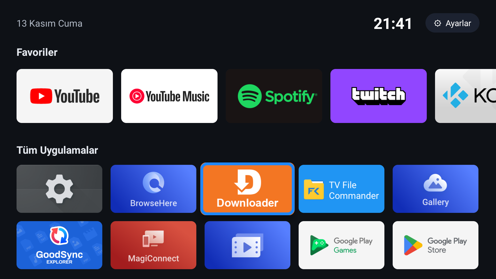
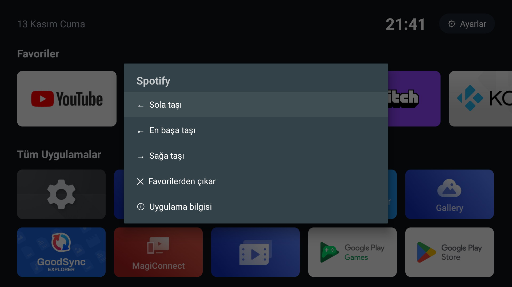

# Hafif Ana Ekran (Hafif Launcher)

Android TV / Google TV için **reklamsız, hızlı ve çok az RAM kullanan** bir ana ekran (launcher).
Üstte favori uygulamalarınız, altta diğer tüm uygulamalar. Öneri satırı, reklam, "Sırada Oynat" veya arka plan servisi yok.

> **English:** A tiny (~21 KB), ad-free, low-RAM home screen for Android TV. Favorites row + all-apps grid, D-pad friendly, no permissions, no libraries, no background services. Built without Gradle.

## Ekran görüntüleri


| Seçili uygulama (mavi çerçeve) | Favori düzenleme menüsü |
|---|---|
|  |  |

*TCL Smart TV Pro, Android TV 11, 1920×1080.*

## İndir

**[⬇ HafifLauncher.apk — en son sürüm](../../releases/latest/download/HafifLauncher.apk)**

Tüm sürümler: [Releases](../../releases)

## Neden?

Bazı TV'lerde (ör. TCL) varsayılan Android TV ana ekranı reklam ve öneri kutularıyla dolu ve 2 GB RAM'li cihazlarda tek başına ~100 MB bellek kullanıyor. Hafif Ana Ekran aynı işi yaklaşık 40 MB ile yapar.

| | Varsayılan Android TV ana ekranı | Hafif Ana Ekran |
|---|---|---|
| RAM (PSS, ölçülen) | ~102 MB | ~39–44 MB |
| APK boyutu | — (sistem uygulaması) | ~21 KB |
| Reklam / öneri satırları | Var | Yok |
| İzinler | Çok sayıda | **Hiç yok** |
| Arka plan servisi | Var | Yok |

*Ölçüm: TCL Smart TV Pro, Android TV 11, 2 GB RAM, `dumpsys meminfo`.*

## Özellikler

- **Favoriler satırı**: yatay kaydırılabilir, büyük afiş (banner) kartları.
- **Tüm Uygulamalar ızgarası**: ekran genişliğine göre otomatik boyutlanan 5 sütun, Türkçe alfabetik sıralama.
- **Belirgin odak**: seçili kartın etrafında kalın mavi çerçeve ve %10 büyüme.
- **Favori düzenleme**: bir kartta kumandanın **MENÜ** tuşu veya **OK'a uzun basma** → Favorilere ekle / Çıkar / Sola-Sağa taşı / En başa taşı / Uygulama bilgisi.
- **Üst çubuk**: tarih, saat ve TV Ayarları kısayolu.
- **Kenarda kilitli gezinme**: satır sonunda odak başka satıra kaçmaz.
- **Tam ekran düzen**, koyu tema.
- Uygulama kurulup kaldırıldığında liste ana ekrana her dönüşte kendiliğinden güncellenir.
- Ana ekranda **Geri** tuşu bir şey yapmaz (yanlışlıkla çıkış olmaz).

## Teknik özellikler

| | |
|---|---|
| Paket adı | `tr.hafif.launcher` |
| Sürüm | 1.0 (versionCode 1) |
| Min SDK | 21 (Android 5.0) |
| Target SDK | 30 (Android 11) |
| Compile SDK | 35 |
| Dil | Java 8 (lambda'lar d8 ile desugar edilir) |
| Bağımlılık | Yok (AndroidX/Leanback kullanılmaz, yalnızca platform API'leri) |
| İzinler | Yok. Uygulama görünürlüğü için yalnızca `<queries>` (MAIN + LEANBACK_LAUNCHER / LAUNCHER) |
| Intent filtreleri | `MAIN` + `HOME` + `DEFAULT` + `LEANBACK_LAUNCHER` |
| Activity | Tek activity, `singleTask`, `stateNotNeeded`, yatay |
| Arayüz | Kodla oluşturulur (XML layout yok): `ScrollView` → `HorizontalScrollView` (favoriler) + satır `LinearLayout`'ları (ızgara) |
| Veri saklama | `SharedPreferences` (`home.xml`, `favs` anahtarı: virgülle ayrılmış paket adları) |
| Uygulama listesi | `PackageManager.queryIntentActivities(LEANBACK_LAUNCHER)` |
| Kart görseli | Önce activity banner'ı, sonra uygulama banner'ı, yoksa ikon + etiket |
| Uygulama açma | `getLeanbackLaunchIntentForPackage`, yoksa `getLaunchIntentForPackage` |
| Derleme | Gradle'sız: `aapt2` → `javac --release 8` → `d8` → `zipalign` → `apksigner` |

## Kurulum

### 1. TV'de hata ayıklamayı açın
1. **Ayarlar → Sistem → Hakkında → Android TV işletim sistemi derlemesi** satırına 7 kez basın.
2. **Ayarlar → Sistem → Geliştirici seçenekleri → USB hata ayıklama**'yı açın.

### 2. APK'yı kurun
```bash
adb connect <TV_IP>:5555
adb -s <TV_IP>:5555 install -r HafifLauncher.apk
```
İlk bağlantıda TV ekranındaki izin isteğini **"Her zaman izin ver"** ile onaylayın.

### 3. Varsayılan ana ekran yapın
```bash
adb -s <TV_IP>:5555 shell cmd package set-home-activity tr.hafif.launcher/.MainActivity
```
Android TV 11'de sistem kendi ana ekranını öncelikli tutar. Ana Ekran tuşu hâlâ eski ekranı açıyorsa eskisini **devre dışı bırakın** (silinmez, geri açılabilir):
```bash
adb -s <TV_IP>:5555 shell pm disable-user --user 0 com.google.android.tvlauncher
```
Google TV arayüzlü cihazlarda paket adı `com.google.android.apps.tv.launcherx` olabilir.

### Geri alma
```bash
adb -s <TV_IP>:5555 shell pm enable com.google.android.tvlauncher
adb -s <TV_IP>:5555 uninstall tr.hafif.launcher
```

## Favorileri ADB ile ayarlama

Varsayılan favoriler yaygın TV uygulamalarıdır (YouTube, Netflix, Prime Video, Disney+, Spotify, Kodi…); yalnızca yüklü olanlar görünür. Kendi listenizi tek komutla verebilirsiniz:

```bash
adb -s <TV_IP>:5555 shell am start -n tr.hafif.launcher/.MainActivity \
  --es set_favs "com.google.android.youtube.tv,com.spotify.tv.android,org.xbmc.kodi"
```

TV'deki uygulama paket adlarını listelemek için:
```bash
adb -s <TV_IP>:5555 shell cmd package query-activities --brief \
  -a android.intent.action.MAIN -c android.intent.category.LEANBACK_LAUNCHER
```

## İsteğe bağlı: reklam paketlerini kapatma (TCL)

Eski ana ekranı kullanmaya devam edecekseniz reklam/öneri kaynaklarını da kapatabilirsiniz. Bu paketler silinmez, `pm enable <paket>` ile geri açılır:

```bash
for p in com.google.android.tvrecommendations com.tcl.partnercustomizer \
         com.tcl.waterfall.overseas com.tcl.esticker com.tcl.messagebox com.tcl.bi \
         com.tcl.appmarket2 com.tcl.showmode; do
  adb -s <TV_IP>:5555 shell pm disable-user --user 0 $p
done
```

## Kaynaktan derleme

Gereksinimler: JDK 17, Android SDK (`build-tools;36.0.0`, `platforms;android-35`), Python 3.

```bash
export ANDROID_HOME=$HOME/Android/Sdk
./build.sh
```

Çıktı: `HafifLauncher.apk`. İmza anahtarı ilk derlemede `~/.android/hafif-launcher.keystore` olarak rastgele bir şifreyle oluşturulur ve depoya girmez. Farklı bir anahtarla imzalanmış APK, mevcut kurulumun üzerine güncelleme olarak kurulamaz; önce eskisini kaldırın.

## Proje yapısı

```
AndroidManifest.xml
build.sh                               # Gradle'sız derleme betiği
res/drawable/ic.xml                    # uygulama ikonu (vektör)
res/drawable/banner.xml                # TV afişi (vektör)
src/tr/hafif/launcher/MainActivity.java
```

## Test edilen cihazlar

- TCL Smart TV Pro (BeyondTV), Android TV 11, 2 GB RAM

## Lisans

[MIT](LICENSE)
