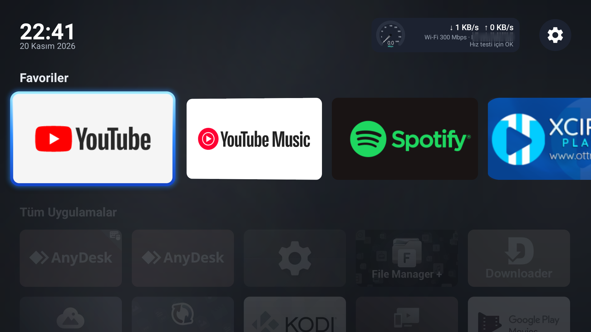
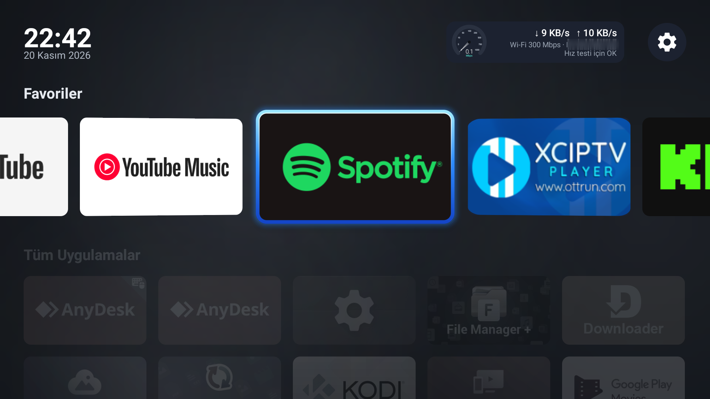
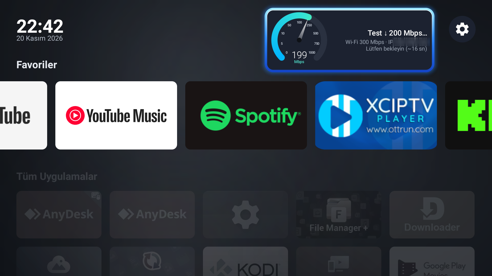
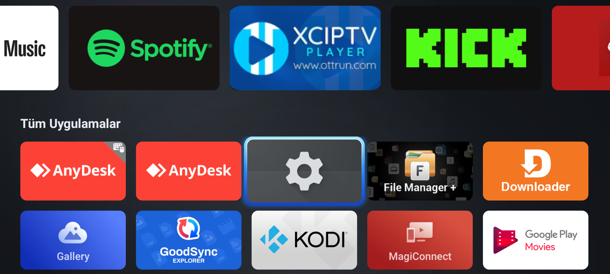
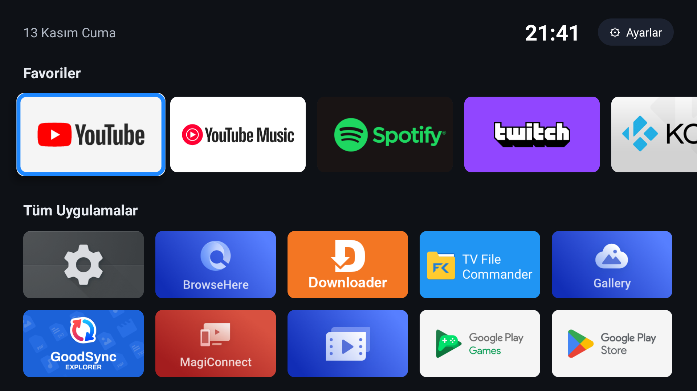

# Hafif Ana Ekran (Hafif Launcher)

Android TV / Google TV için **reklamsız, hızlı ve az RAM kullanan** bir ana ekran (launcher).
Üstte favori uygulamalarınız, altta diğer tüm uygulamalar. Öneri satırı, reklam veya "Sırada Oynat" yok.

> **English:** A tiny (~41 KB), ad-free, low-RAM home screen for Android TV. Favorites carousel + all-apps grid, built-in network speed gauge and speed test, calm animated backdrop, D-pad friendly. No libraries, no background services. Built without Gradle.

## Ekran görüntüleri (v1.1)



| Favorilerde seçim (ortalanır, komşular eğilir) | Hız testi (ibre büyür) |
|---|---|
|  |  |

| Tüm Uygulamalar (odakla belirginleşir) |
|---|
|  |

*TCL Smart TV Pro, Android TV 11, 1920×1080.*

<details>
<summary>1.0 sürümünün ekran görüntüleri</summary>



| Seçili uygulama | Favori düzenleme menüsü |
|---|---|
|  |  |

</details>

## İndir

| Sürüm | İndir | Notlar |
|---|---|---|
| **1.1 (en yeni)** | **[⬇ HafifLauncher.apk — v1.1](../../releases/download/v1.1/HafifLauncher.apk)** | Hız göstergesi ve hız testi, hareketli duvar kâğıdı, 3B efektler. İnternet izni kullanır (yalnızca hız testi için). |
| 1.0 | [⬇ HafifLauncher.apk — v1.0](../../releases/download/v1.0/HafifLauncher.apk) | En sade sürüm. **Hiç izin istemez**, internete hiç bağlanmaz. |

Her zaman en son sürüm: [releases/latest](../../releases/latest/download/HafifLauncher.apk) · Tüm sürümler: [Releases](../../releases)

İki sürüm de aynı anahtarla imzalıdır: 1.1, 1.0'ın üzerine güncelleme olarak kurulur ve favoriler korunur.

## 1.1'de yenilikler

### Üst çubuk
- **Saat ve tarih solda**: büyük saat, hemen altında aynı genişlikte "gün ay yıl" tarih (genişlik otomatik eşitlenir).
- **Ayarlar** butonu yalnızca yuvarlak bir çark simgesi.
- **İnternet hızı kutusu**:
  - Anlık indirme ve yükleme hızı (↓/↑, saniyede bir; KB/s – MB/s).
  - Bağlantı türü ve **Wi-Fi bağlantı hızı** (ör. "Wi-Fi 300 Mbps"), cihazın **yerel IP adresi**.
  - **İbreli hız göstergesi** (0 – 1000 Mbps, kademeli ölçek: 0, 5, 10, 50, 100, 250, 500, 750, 1000; mavi → turkuaz → yeşil yay). Normalde anlık indirme hızını gösterir.
  - **Hız testi**: kutuya OK ile basınca ~16 sn'lik test (8 sn indirme + 8 sn yükleme, 4 paralel bağlantı). Test sırasında gösterge büyür ve hafifçe yukarı kayar, bitince küçülür; sonuç ibrede 15 sn kalır, yazıda saklanır.
  - Test sunucuları: Cloudflare (`speed.cloudflare.com`); reddederse (ör. HTTP 429) otomatik olarak OVH ve Hetzner'e geçilir. Hata olursa sebebi ekranda yazar.

### Favoriler
- **Daha büyük kartlar** (ekranda ~3,5 kart).
- **Seçili kart ortada**: sağa-sola gidildikçe seçili kart ekranın ortasında kalır; listenin başında ve sonunda kaydırma durur, seçim kenardaki karta gider.
- **3B komşu eğimi**: seçili kartın solundaki ve sağındaki kartların seçili karta bakan kenarları 18° arkaya kıvrılır; boşluklar iki yanda eşittir.
- **Işık efekti**: bir kartta 3 sn beklenince üzerinden hafif mavi tonlu, eğik bir ışık geçer ve kart seçili kaldıkça her 3 sn'de bir tekrarlar.

### Görünüm
- **3B parıltılı odak çerçevesi**: üstte açık turkuaz, altta koyu mavi geçişli şerit, iç kenarda beyaz parlama ve dışa sönen mavi hale. Favorilerde, ızgarada, hız kutusunda ve çarkta aynı.
- **Tüm Uygulamalar** odak orada değilken neredeyse kararmış ve soluktur (%15 görünür); aşağı inince yumuşakça belirginleşir.
- **Seçili satır dikeyde ortalanır**: Tüm Uygulamalar'da aşağı indikçe sayfa seçili satırı ortaya kaydırır.
- **Hareketli duvar kâğıdı**: koyu zeminde dört büyük, yumuşak kenarlı gri ışık bulutu çok yavaş süzülür (bir tur 1,5–2,5 dk). Göz yormaz.

### Performans ve uyumluluk
- Duvar kâğıdı ayrı bir yüzeyde (`SurfaceView`) ve ayrı iş parçacığında, 120×68 çözünürlükte ~8 fps çizilir; büyütmeyi ekran donanımı yapar. Ana ekranın kartları bu yüzden yeniden çizilmez (ölçülen pay: tek çekirdeğin ~%2,4'ü). Ana ekran görünmezken tamamen durur.
- Işık efekti ~30 fps ile sınırlıdır.
- **Animasyonlar sistemin "Animatör süre ölçeği" ayarından bağımsızdır**: TV'de animasyonlar kapatılmış olsa (ölçek 0) bile efektler çalışır.
- Ok tuşları kaydırma kaplarının kendi mantığına değil sistemin odak geçişine bırakılır (hızlı basışta geri sıçrama yok).

## Neden?

Bazı TV'lerde (ör. TCL) varsayılan Android TV ana ekranı reklam ve öneri kutularıyla dolu ve 2 GB RAM'li cihazlarda tek başına ~100 MB bellek kullanıyor.

| | Varsayılan Android TV ana ekranı | Hafif Ana Ekran 1.0 | Hafif Ana Ekran 1.1 |
|---|---|---|---|
| RAM (PSS, ölçülen) | ~102 MB | ~39–44 MB | ~51–53 MB |
| APK boyutu | — (sistem uygulaması) | ~21 KB | ~41 KB |
| Reklam / öneri satırları | Var | Yok | Yok |
| İzinler | Çok sayıda | **Hiç yok** | İnternet, ağ durumu, Wi-Fi durumu |
| Arka plan servisi | Var | Yok | Yok |

*Ölçüm: TCL Smart TV Pro, Android TV 11, 2 GB RAM, `dumpsys meminfo`. 1.1'deki ek bellek hız testi (HTTPS) ve efektlerden gelir.*

## Tüm özellikler

- **Favoriler satırı**: büyük afiş (banner) kartları, ortalanan seçim, 3B komşu eğimi, ışık efekti.
- **Tüm Uygulamalar ızgarası**: ekran genişliğine göre boyutlanan 5 sütun, Türkçe alfabetik sıralama, odakla belirginleşme.
- **Favori düzenleme**: bir kartta kumandanın **MENÜ** tuşu veya **OK'a uzun basma** → Favorilere ekle / Çıkar / Sola-Sağa taşı / En başa taşı / Uygulama bilgisi.
- **Üst çubuk**: saat, tarih, internet hızı kutusu (ibre, hız testi, Wi-Fi hızı, IP), Ayarlar çarkı.
- **Hareketli gri duvar kâğıdı**, koyu tema, tam ekran düzen.
- Uygulama kurulup kaldırıldığında liste ana ekrana her dönüşte kendiliğinden güncellenir.
- Ana ekranda **Geri** tuşu bir şey yapmaz (yanlışlıkla çıkış olmaz).

## Gizlilik

- Hesap, reklam, takip ve analitik yoktur.
- **1.1** internete yalnızca **hız testi butonuna basıldığında** bağlanır; test, rastgele veri indirip yükler (Cloudflare, gerekirse OVH / Hetzner). Bu sunuculara bağlantının doğası gereği cihazın internet adresi ve `HafifLauncher` istemci adı dışında bir bilgi gönderilmez. Her test, bağlantı hızına göre yaklaşık 100–200 MB veri kullanır.
- Wi-Fi bağlantı hızı ve yerel IP yalnızca cihazda okunur ve ekranda gösterilir.
- **1.0** hiçbir izin istemez ve internete hiç bağlanmaz.

## Teknik özellikler

| | |
|---|---|
| Paket adı | `tr.hafif.launcher` |
| Sürüm | 1.1 (versionCode 2) |
| Min SDK | 21 (Android 5.0) |
| Target SDK | 30 (Android 11) |
| Compile SDK | 35 |
| Dil | Java 8 (lambda'lar d8 ile desugar edilir) |
| Bağımlılık | Yok (AndroidX/Leanback kullanılmaz, yalnızca platform API'leri) |
| İzinler | `INTERNET` (hız testi), `ACCESS_NETWORK_STATE` (bağlantı türü), `ACCESS_WIFI_STATE` (Wi-Fi hızı); uygulama görünürlüğü için `<queries>` |
| Intent filtreleri | `MAIN` + `HOME` + `DEFAULT` + `LEANBACK_LAUNCHER` |
| Activity | Tek activity, `singleTask`, `stateNotNeeded`, yatay |
| Arayüz | Kodla oluşturulur (XML layout yok). Ortalayan kaydırma kapları (`CenterScroll.H/V`), özel çizilen ibre (`GaugeView`), odak çerçevesi (`FocusRing`), ışık efekti (`Shine`) |
| Duvar kâğıdı | `SurfaceView` + ayrı iş parçacığı, 1/16 çözünürlük, ~8 fps, `RadialGradient` bulutlar |
| Animasyon | Kendi zamanlayıcısı (`Anim`, `postOnAnimation` + gerçek saat): sistem animasyon ölçeğinden bağımsız |
| Anlık hız | `TrafficStats` (tüm cihaz), saniyede bir |
| Hız testi | `HttpURLConnection`, 4 paralel bağlantı, 8 + 8 sn; sunucu yedekli |
| Veri saklama | `SharedPreferences` (`home.xml`, `favs` anahtarı: virgülle ayrılmış paket adları) |
| Uygulama listesi | `PackageManager.queryIntentActivities(LEANBACK_LAUNCHER)` |
| Kart görseli | Önce activity banner'ı, sonra uygulama banner'ı, yoksa ikon + etiket |
| Derleme | Gradle'sız: `aapt2` → `javac --release 8` → `d8` → `zipalign` → `apksigner` |

## Kurulum

### 1. TV'de hata ayıklamayı açın
1. **Ayarlar → Sistem → Hakkında → Android TV işletim sistemi derlemesi** satırına 7 kez basın.
2. **Ayarlar → Sistem → Geliştirici seçenekleri → USB hata ayıklama**'yı açın.

### 2. APK'yı kurun
```bash
adb connect <TV_IP>:5555
adb -s <TV_IP>:5555 install -r HafifLauncher.apk
```
İlk bağlantıda TV ekranındaki izin isteğini **"Her zaman izin ver"** ile onaylayın. 1.0 kuruluysa aynı komut 1.1'e günceller; favoriler korunur.

### 3. Varsayılan ana ekran yapın
```bash
adb -s <TV_IP>:5555 shell cmd package set-home-activity tr.hafif.launcher/.MainActivity
```
Android TV 11'de sistem kendi ana ekranını öncelikli tutar. Ana Ekran tuşu hâlâ eski ekranı açıyorsa eskisini **devre dışı bırakın** (silinmez, geri açılabilir):
```bash
adb -s <TV_IP>:5555 shell pm disable-user --user 0 com.google.android.tvlauncher
```
Google TV arayüzlü cihazlarda paket adı `com.google.android.apps.tv.launcherx` olabilir.

### 1.1'den 1.0'a dönmek
Android eski sürümü yenisinin üzerine kurmaz; önce kaldırıp sonra 1.0'ı kurun (favoriler sıfırlanır). 1.0 APK'sını yukarıdaki tablodan indirip `HafifLauncher-1.0.apk` adıyla kaydettiğinizi varsayıyoruz:
```bash
adb -s <TV_IP>:5555 uninstall tr.hafif.launcher
adb -s <TV_IP>:5555 install HafifLauncher-1.0.apk
```

### Geri alma (varsayılan ana ekrana dönüş)
```bash
adb -s <TV_IP>:5555 shell pm enable com.google.android.tvlauncher
adb -s <TV_IP>:5555 uninstall tr.hafif.launcher
```

## Favorileri ADB ile ayarlama

Varsayılan favoriler yaygın TV uygulamalarıdır (YouTube, Netflix, Prime Video, Disney+, Spotify, Kodi…); yalnızca yüklü olanlar görünür. Kendi listenizi tek komutla verebilirsiniz:

```bash
adb -s <TV_IP>:5555 shell am start -n tr.hafif.launcher/.MainActivity \
  --es set_favs "com.google.android.youtube.tv,com.spotify.tv.android,org.xbmc.kodi"
```

TV'deki uygulama paket adlarını listelemek için:
```bash
adb -s <TV_IP>:5555 shell cmd package query-activities --brief \
  -a android.intent.action.MAIN -c android.intent.category.LEANBACK_LAUNCHER
```

## İsteğe bağlı: reklam paketlerini kapatma (TCL)

Eski ana ekranı kullanmaya devam edecekseniz reklam/öneri kaynaklarını da kapatabilirsiniz. Bu paketler silinmez, `pm enable <paket>` ile geri açılır:

```bash
for p in com.google.android.tvrecommendations com.tcl.partnercustomizer \
         com.tcl.waterfall.overseas com.tcl.esticker com.tcl.messagebox com.tcl.bi \
         com.tcl.appmarket2 com.tcl.showmode; do
  adb -s <TV_IP>:5555 shell pm disable-user --user 0 $p
done
```

## Kaynaktan derleme

Gereksinimler: JDK 17, Android SDK (`build-tools;36.0.0`, `platforms;android-35`), Python 3.

```bash
export ANDROID_HOME=$HOME/Android/Sdk
./build.sh
```

Çıktı: `HafifLauncher.apk`. İmza anahtarı ilk derlemede `~/.android/hafif-launcher.keystore` olarak rastgele bir şifreyle oluşturulur ve depoya girmez. Farklı bir anahtarla imzalanmış APK, mevcut kurulumun üzerine güncelleme olarak kurulamaz; önce eskisini kaldırın.

## Proje yapısı

```
AndroidManifest.xml
build.sh                                 # Gradle'sız derleme betiği
res/drawable/ic.xml                      # uygulama ikonu (vektör)
res/drawable/banner.xml                  # TV afişi (vektör)
res/drawable/ic_settings.xml             # ayarlar çarkı (vektör)
src/tr/hafif/launcher/MainActivity.java  # ana ekran, favoriler, ızgara, odak ve efektler
src/tr/hafif/launcher/NetMeter.java      # internet hızı kutusu ve hız testi
src/tr/hafif/launcher/GaugeView.java     # ibreli hız göstergesi
src/tr/hafif/launcher/Backdrop.java      # hareketli duvar kâğıdı (SurfaceView)
src/tr/hafif/launcher/FocusRing.java     # 3B parıltılı odak çerçevesi
src/tr/hafif/launcher/Shine.java         # favori ışık efekti
src/tr/hafif/launcher/CenterScroll.java  # seçili öğeyi ortalayan kaydırma kapları
src/tr/hafif/launcher/Anim.java          # sistem ölçeğinden bağımsız animasyon zamanlayıcısı
```

## Sürüm geçmişi

- **1.1** — İnternet hızı kutusu (ibre, hız testi, Wi-Fi hızı, IP), yeni üst çubuk, büyük ve ortalanan favoriler, 3B komşu eğimi, tekrarlayan ışık efekti, 3B odak çerçevesi, kararan Tüm Uygulamalar, hareketli duvar kâğıdı, sistem animasyon ayarından bağımsız animasyonlar.
- **1.0** — İlk sürüm: favoriler satırı, Tüm Uygulamalar ızgarası, favori düzenleme, izin gerektirmeyen sade ana ekran.

## Test edilen cihazlar

- TCL Smart TV Pro (BeyondTV), Android TV 11, 2 GB RAM (iki ayrı cihaz)

## Lisans

[MIT](LICENSE)
